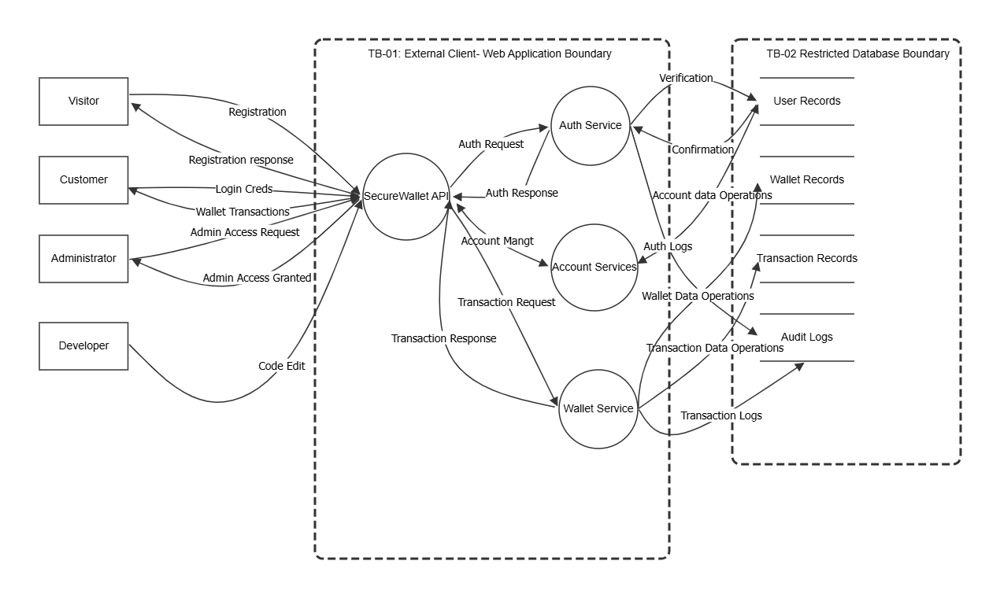
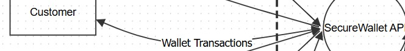

# SecureWallet: Practical Application Threat Modeling Walkthrough

This repository demonstrates the threat-modelling process using SecureWallet, a simulated digital wallet application, as a practical case study. It also provides a repeatable walkthrough that you can apply to an application of your choice.

You do not need to build an application yourself. You can use an existing application, an open-source project, a practice lab, or a documented application design that you are authorised to assess.

---

## ⚠️ Disclaimer

This repository is intended for educational purposes, application security learning and authorised security assessments.

Only assess applications, source code and environments that you own or have explicit permission to examine.

---

## What Is Application Threat Modeling?

Application threat modelling is a structured process for understanding an application's architecture, identifying potential threats, assessing associated risks and determining appropriate security measures.

This walkthrough follows the Four Threat Modelling Question Framework:

1. **What are we working on?**
2. **What can go wrong?**
3. **What are we going to do?**
4. **Did we do a good job?**

The STRIDE methodology is used to identify and categorise potential threats.
---

## Requirements

- A computer with internet access.
- An application to assess, or access to its design and documentation.
- A Markdown editor, such as Visual Studio Code.
- A diagramming or threat-modelling tool.
- Basic understanding of application architecture and web applications.

### Choosing an application

You do not need to develop your own application.

You can use:

1. Your own application.
2. An existing open-source application.
3. A deliberately vulnerable practice application.
4. An application design, architecture specification or system documentation.

Where source code is unavailable, you can work from architecture diagrams and system documentation. Record any assumptions and information gaps rather than treating them as verified facts.

Only perform testing within your authorised scope.

---

# Project Walkthrough

## Stage 1: What Are We Working On?

Before identifying threats, understand the application and how it operates.

### Choosing a diagramming tool

This walkthrough uses **OWASP Threat Dragon** as its primary threat-modelling tool.

Threat Dragon is an open-source OWASP tool for creating threat models and representing application architecture.

- [OWASP Threat Dragon](https://threatdragon.com/)
- [Threat Dragon GitHub repository](https://github.com/OWASP/threat-dragon)

Other suitable tools include:

- [diagrams.net (draw.io)](https://www.diagrams.net/)
- [Microsoft Visio](https://www.microsoft.com/en-us/microsoft-365/visio/flowchart-software)
- [Lucidchart](https://www.lucidchart.com/)

The tool is not mandatory. What matters is producing a clear representation of the application's components, data flows and trust boundaries.

### Walkthrough

1. Select an application.
2. Understand its purpose and functionality.
3. Define the assessment scope.
4. Identify users and external entities.
5. Identify application components and dependencies.
6. Identify important assets and sensitive data.
7. Understand how information moves through the system.
8. Create a Data Flow Diagram.
9. Identify trust boundaries and entry points.
10. Save and export the diagram.

### SecureWallet Case Study: Application Architecture

The following diagram presents the SecureWallet application architecture and data flows used as the basis for the threat analysis.

**SecureWallet Data Flow Diagram**

The DFD provides the foundation for the next stage: identifying potential threats associated with the application's components and data flows.

**Continue:** [System Architecture](01-understanding-the-application/system-architecture.md) | [Data Flow Diagram](01-understanding-the-application/data-flow-diagram.md)

---

## Stage 2: What Can Go Wrong?

This stage examines the application's components and data flows to identify potential security threats.

The analysis uses STRIDE:

| STRIDE category | Description |
|---|---|
| Spoofing | Impersonating a user, service or other entity |
| Tampering | Unauthorised modification of data or processes |
| Repudiation | Actions that cannot be reliably traced or attributed |
| Information Disclosure | Unauthorised exposure of sensitive information |
| Denial of Service | Disruption of system availability |
| Elevation of Privilege | Gaining permissions beyond those authorised |

### How Threat Identification Works

Rather than applying STRIDE to the application as one large system, this walkthrough examines individual components and interactions shown in the DFD.

For each relevant interaction:

1. Locate the interaction on the full DFD.
2. Create a zoomed-in snapshot showing the relevant component or data flow.
3. Identify potential threats using STRIDE.
4. Document each threat and its attack scenario.
5. Identify affected assets and components.
6. Assess likelihood, impact and risk.
7. Assign a unique threat identifier and priority.

### Threat Analysis: SecureWallet Case Study

Threat identification involves examining an application's components, data flows and trust boundaries to determine how they could be abused or compromised.

This walkthrough uses **STRIDE**, a threat-classification methodology that helps identify six categories of security threats:

- **Spoofing:** Impersonating a legitimate user or system.
- **Tampering:** Modifying data or processes without authorisation.
- **Repudiation:** Performing actions without sufficient evidence to trace them.
- **Information Disclosure:** Exposing sensitive information to unauthorised parties.
- **Denial of Service:** Disrupting the availability of an application or service.
- **Elevation of Privilege:** Gaining permissions beyond those legitimately granted.

Other threat-modelling methodologies include **PASTA** (Process for Attack Simulation and Threat Analysis), **LINDDUN** (privacy threat modelling), **OCTAVE** (Operationally Critical Threat, Asset, and Vulnerability Evaluation) and **Attack Tree Analysis**. Each offers a different approach, depending on the application's security objectives and assessment requirements.

For this case study, STRIDE is applied to individual components and interactions represented in the SecureWallet Data Flow Diagram (DFD).

#### How Threat Identification Works

For each relevant interaction:

1. Locate the component or data flow on the full DFD.
2. Create a zoomed-in snapshot highlighting the relevant interaction.
3. Examine the interaction using the applicable STRIDE categories.
4. Identify potential threats and describe realistic attack scenarios.
5. Identify affected assets and application components.
6. Assess likelihood, impact and overall risk.
7. Assign a unique threat identifier and priority.

#### SecureWallet Case Study: Threat Analysis

The SecureWallet analysis examines the following application interactions:

1. **User registration and authentication** – Registration, login and authenticated user-profile requests.
2. **Wallet operations** – Retrieving the authenticated user's wallet and performing simulated wallet funding.
3. **Fund transfers** – Processing transfer requests, checking balances, updating wallets and recording transactions.
4. **Transaction history** – Retrieving transaction records associated with the authenticated user's wallet.

Each interaction is examined for relevant threats. The findings are documented in the threat analysis and threat register.

#### Worked Example: Transaction History – Broken Object Level Authorization (BOLA)

The following example demonstrates how a potential threat is identified against a specific application interaction and recorded in the SecureWallet Threat Register.
An authenticated customer requests their transaction history through the SecureWallet API. The API passes the request to the Wallet and Transaction Service, which retrieves the relevant transaction records.

**DFD close-up – TH-12: Unauthorized Access to Another Customer's Transaction History**

The highlighted interaction is assessed for potential unauthorized access to transaction records belonging to another customer.

**Threat identified: TH-12**

| Threat Register Field | SecureWallet Assessment |
|---|---|
| **Threat ID** | TH-12 |
| **Threat** | Unauthorized Access to Another Customer's Transaction History |
| **STRIDE Category** | Information Disclosure |
| **Affected Components** | SecureWallet API; Wallet & Transaction Service; Transaction Records |
| **Attack Scenario** | A customer changes a transaction or wallet identifier in an API request to retrieve another customer's transaction history. |
| **Likelihood** | 4 – High |
| **Impact** | 4 – High |
| **Inherent Risk** | **16 – High** |
| **Recommended Security Controls** | Enforce ownership checks on transaction-history requests; derive customer identity from the authenticated context; apply object-level authorization; return only information the requesting customer is permitted to view. |
| **Verification Evidence** | Automated tests validated that users cannot access transaction records belonging to other customers. |
| **Residual Risk** | Requires reassessment following implementation and security testing. |
| **Status** | Security controls implemented; validation evidence documented.|

This example shows how a potential attack scenario is connected to a specific DFD interaction, classified using STRIDE, assessed for risk, and documented with recommended security controls and verification evidence.

The same process is repeated for the other relevant interactions in the application. A single interaction may produce multiple threats, and each threat should receive its own unique identifier and assessment in the Threat Register.

See the [STRIDE Analysis](02-identifying-threats/stride-analysis.md) and the [SecureWallet Threat Register](03-threat-mitigation/threat-register.md) for the complete assessment.

---

## Stage 3: What Are We Going to Do?

After identifying potential threats, determine how each should be addressed.

Possible risk treatments include:

- **Mitigate:** Introduce security controls to reduce risk.
- **Eliminate:** Remove the feature, interface or condition creating the risk.
- **Transfer:** Allocate responsibility for managing the risk to another party.
- **Accept:** Formally acknowledge and accept the remaining risk.

### Walkthrough

1. Review the identified threats.
2. Determine the appropriate risk treatment.
3. Recommend relevant security controls.
4. Map each mitigation to its associated threat.
5. Document the reason for each security decision.
6. Identify which controls have been implemented.
7. Reference implementation evidence where available.

### SecureWallet Case Study

Selected threats informed the security controls implemented in the companion SecureWallet API application, including:

- **Authentication:** Argon2id password hashing and JWT-based authentication.
- **Access control:** Authenticated access to wallet and transaction-history endpoints, with transaction records scoped to the requesting user's wallets.
- **Transfer security:** Balance checks, atomic wallet updates and idempotency handling to reduce the risk of inconsistent or duplicate transfers.
- **Abuse prevention:** Rate limiting on registration and login endpoints.

The documentation distinguishes between recommended controls, implemented controls and controls that have been validated through testing.

A proposed mitigation must not be described as implemented unless there is implementation evidence. Similarly, implementation alone does not establish that a control has been validated.

See the [security mitigation strategy](03-threat-mitigation/security-mitigations.md) and [threat register](03-threat-mitigation/threat-register.md).

---

## Stage 4: Did We Do a Good Job?

The final stage evaluates whether the selected controls adequately address the identified threats.

### Walkthrough

1. Develop a security test plan.
2. Map tests to identified threats and mitigations.
3. Perform appropriate security checks.
4. Record evidence and test results.
5. Identify unresolved threats and residual risks.
6. Document recommendations and limitations.

### SecureWallet Case Study

The companion implementation was evaluated using automated tests and supporting security assessment tools.

The test suite contains 19 passing tests covering authentication, wallet operations, transaction handling and security-related behaviour.

Additional security checks were performed using Bandit, Semgrep, pip-audit and Gitleaks. The assessment results and their limitations are documented in the security assessment report.

Test results demonstrate the behaviour of the controls under the conditions tested. They do not, by themselves, establish that the application is free from vulnerabilities or replace an independent penetration test.

See the [security test plan](04-security-validation/security-test-plan.md) and [assessment results](04-security-validation/security-assessment-report.md).

---

## Supporting Documentation

The repository includes supporting documentation for the SecureWallet threat-modelling exercise. These can serve as reusable templates:

- [System Architecture](01-understanding-the-application/system-architecture.md)
- [Data Flow Diagram Documentation](01-understanding-the-application/data-flow-diagram.md)
- [STRIDE Analysis](02-identifying-threats/stride-analysis.md)
- [Threat Register](03-threat-mitigation/threat-register.md)
- [Security Mitigation Strategy](03-threat-mitigation/security-mitigations.md)
- [Security Test Plan](04-security-validation/security-test-plan.md)
- [Security Assessment Report](04-security-validation/security-assessment-report.md)

---

## Companion Project: SecureWallet API

SecureWallet is a simulated digital wallet API developed to demonstrate the practical application of selected security controls.

This repository focuses on the threat-modelling process. The companion repository contains the API implementation, security controls, automated tests and supporting technical documentation.

[**Explore the SecureWallet API implementation**](https://github.com/VeronicaPeters/SecureWallet)

---

## Expected Learning Outcome

By completing this walkthrough, you should be able to produce a structured threat model for an application of your choice.

Your deliverables should include:

- Application scope and architecture.
- Data Flow Diagram.
- Assets, trust boundaries and entry points.
- STRIDE-based threat analysis.
- Threat-specific DFD snapshots.
- Threat register and risk assessment.
- Recommended security mitigations.
- Security test plan and assessment results.

The objective is not simply to create a list of threats. It is to understand how an application works, identify where threats may arise, assess their potential impact and make informed security decisions.
